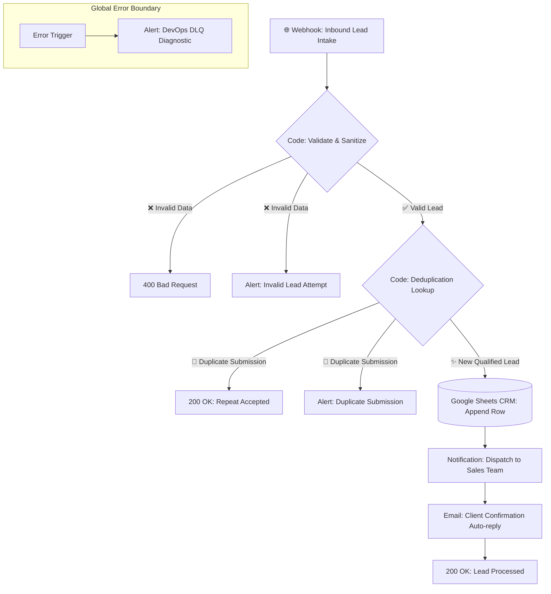

# ⚡ B2B Lead Automation, Deduplication & Multichannel Pipeline (n8n)

[](https://n8n.io)
[](LICENSE)
[](#environment-variables--credentials)
[](#)

> **Production-grade automated lead lifecycle management pipeline built with n8n.**  
> Streamlines inbound B2B prospect handling from webhook ingestion through regex/E.164 sanitization, 24-hour hash deduplication, atomic Google Sheets CRM synchronization, real-time team alerts, personalized customer auto-replies, and enterprise Dead-Letter Queue (DLQ) error recovery.

---

## 🎯 Architecture & Automated Operations

1. **Inbound Webhook Ingestion:** Accepts structured JSON payloads from web contact forms, landing pages (Webflow, WordPress, Tally, Typeform), or client-side JavaScript apps.
2. **Sanitization & Strict Validation (Code Node):**
   * Verifies RFC-compliant email formatting via regex.
   * Normalizes international phone numbers into clean numeric strings (E.164 compliance).
   * Rejects malformed requests with `HTTP 400 Bad Request` and dispatches immediate warning alerts to management.
3. **Smart Hash Deduplication (24-Hour Window):**
   * Computes a deterministic `email_phone` composite signature.
   * Prevents database bloat and duplicate sales outreach by logging repeat requests without inserting redundant CRM rows.
4. **Atomic CRM Synchronization:** Automatically registers qualified prospects into Google Sheets CRM with immutable timestamps, lead source tags, and initial status.
5. **Multichannel Real-Time Dispatch:**
   * **Sales Notification:** Instant actionable alert card with direct contact details.
   * **Customer Confirmation:** Professional automated email acknowledging request receipt with SLA guarantees.
6. **Error Boundary & Dead-Letter Queue (DLQ):** Integrated `Error Trigger` node intercepts upstream API timeouts or credential failures, formatting diagnostic alerts with execution IDs and node names for zero-downtime maintenance.

---

## 🏗️ Workflow Diagram



---

## 🚀 Quickstart & Deployment

### Step 1: Import Workflow into n8n
1. Download or clone this repository and locate [`workflow.json`](workflow.json).
2. Open your n8n workspace (Self-Hosted Docker or n8n Cloud).
3. Navigate to **Workflows ➔ Import from File** and select `workflow.json`.

### Step 2: Configure Environment Variables
This workflow uses zero hardcoded secrets. Set the following environment variables or configure credentials via standard n8n credential managers:
* `TELEGRAM_MANAGER_CHAT_ID` — Target chat ID for sales notifications.
* `GOOGLE_SHEETS_CRM_ID` — Target Google Spreadsheet document ID.
* `SMTP_FROM_EMAIL` — Outbound sender address for automated confirmation emails.
* `TELEGRAM_DEVOPS_CHAT_ID` — Destination for DLQ error diagnostics.

---

## 🧪 Edge-Case Verification (cURL Examples)

Execute test requests against your webhook endpoint (`/webhook/b2b-lead-intake`):

### 1. Valid B2B Lead Submission
```bash
curl -X POST "http://localhost:5678/webhook/b2b-lead-intake" \
     -H "Content-Type: application/json" \
     -d '{
       "name": "Alexander Miller",
       "email": "a.miller@techcorp-demo.com",
       "phone": "+1 415 555 2671",
       "company": "TechCorp Logistics",
       "message": "Interested in enterprise licensing and team rollout."
     }'
```
*Outcome:* `HTTP 200 OK` ➔ Row added to CRM ➔ Alert dispatched ➔ Confirmation email sent.

### 2. Duplicate Submission (Hash Match)
```bash
curl -X POST "http://localhost:5678/webhook/b2b-lead-intake" \
     -H "Content-Type: application/json" \
     -d '{
       "name": "Alexander Miller",
       "email": "a.miller@techcorp-demo.com",
       "phone": "+1 415 555 2671",
       "is_test_duplicate": true
     }'
```
*Outcome:* `HTTP 200 OK` ➔ Duplicate flagged ➔ CRM write skipped ➔ Account manager notified.

### 3. Invalid Email Format
```bash
curl -X POST "http://localhost:5678/webhook/b2b-lead-intake" \
     -H "Content-Type: application/json" \
     -d '{
       "name": "Alex",
       "email": "alex_invalid_email",
       "phone": "+1 415 555 0000"
     }'
```
*Outcome:* `HTTP 400 Bad Request` ➔ `{"status": "error", "message": "Invalid email format"}`.

---

## 💻 Standalone Verification Suite

A standalone Python test runner is included to verify the logic and edge-case handling offline:
```bash
python test_webhook_simulator.py
```

---

## 📄 License
This project is open-source under the [MIT License](LICENSE).
