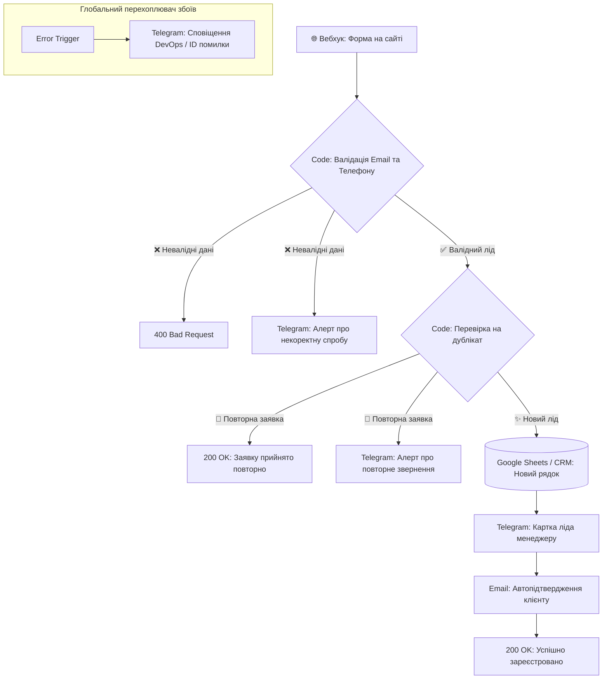

# ⚡ B2B Lead Automation, Deduplication & Multichannel Pipeline (n8n)

[](https://n8n.io)
[](LICENSE)
[](#security--credentials)
[](#)

> **Повноцінний production-ready workflow для платформи n8n.**  
> Автоматизує весь життєвий цикл вхідної B2B-заявки: прийом вебхука з сайту ➔ валідація формату email/телефону ➔ перевірка на дублікати (дедуплікація) ➔ запис у Google Sheets CRM ➔ миттєвий Telegram-алерт менеджеру ➔ персоналізований email-автовідповідь клієнту ➔ гілка обробки помилок (Dead-Letter Queue).

---

## 🎯 Що саме автоматизовано

1. **Прийом даних (Webhook Intake):** Приймає JSON-пейлоад з будь-якої форми (WordPress, Tally, Typeform, Webflow або кастомний JS).
2. **Валідація та нормалізація (Code Node):**
   * Перевірка email регулярним виразом (RFC-сумісний regex).
   * Нормалізація номера телефону до міжнародного цифрового формату (E.164).
   * Якщо дані невалідні — повертає `HTTP 400 Bad Request` з описом помилки та надсилає попередження менеджеру.
3. **Захист від дублікатів (Deduplication Check):**
   * Формує цифровий хеш `email_phone`.
   * Якщо клієнт уже надсилав заявку протягом 24 годин — система **не засмічує таблицю CRM повторним рядком**, а надсилає менеджеру спеціальний алерт: *«🔁 Повторна заявка від існуючого клієнта»*.
4. **CRM-запис:** Атомарне додавання кваліфікованого ліда в Google Sheets із таймстампом та джерелом трафіку.
5. **Мультиканальне сповіщення:**
   * **Telegram відділу продажів:** Картка ліда з клікабельними контактами для швидкого дзвінка.
   * **Email клієнту:** Теплий фірмовий автоответ із підтвердженням прийому звернення.
6. **Error Boundary & DLQ (Error Trigger):** Будь-який збій API (таймаут таблиць, збій пошти) перехоплюється окремою нодою `Error Trigger` і надсилається в чат чергового інженера із зазначенням ID збою та назви вузла.

---

## 🏗️ Архітектура процесу (Workflow Schema)



---

## 🚀 Як імпортувати та запустити за 1 хвилину

### Крок 1. Імпорт у n8n
1. Завантажте файл [`workflow.json`](workflow.json).
2. Відкрийте ваш екземпляр n8n (хмарний або Self-Hosted Docker).
3. Натисніть **Add Workflow ➔ Import from File** і виберіть `workflow.json`.

### Крок 2. Налаштування змінних (без хардкоду)
У workflow використано змінні середовища `$env`:
* `TELEGRAM_MANAGER_CHAT_ID` — ID чату відділу продажів.
* `GOOGLE_SHEETS_CRM_ID` — ID вашої таблиці лідів.
* `SMTP_FROM_EMAIL` — адреса відправника листів.
*(Або просто вкажіть відповідні Credentials у стандартних полях n8n).*

---

## 🧪 Тестування крайових випадків (cURL)

Для перевірки роботи сценарію виконайте команди в терміналі:

### Тест 1: Успішний новий лід
```bash
curl -X POST "http://localhost:5678/webhook/b2b-lead-intake" \
     -H "Content-Type: application/json" \
     -d '{
       "name": "Олександр Мельник",
       "email": "oleksandr.m@techcorp.ua",
       "phone": "+380 50 123 4567",
       "company": "TechCorp Logistics",
       "message": "Цікавить підключення тарифу на 50 водіїв."
     }'
```
*Результат:* `HTTP 200` ➔ запис у Sheets ➔ алерт у Telegram ➔ лист клієнту.

### Тест 2: Повторна заявка (дублікат)
```bash
curl -X POST "http://localhost:5678/webhook/b2b-lead-intake" \
     -H "Content-Type: application/json" \
     -d '{
       "name": "Олександр Мельник",
       "email": "oleksandr.m@techcorp.ua",
       "phone": "+380 50 123 4567",
       "is_test_duplicate": true
     }'
```
*Результат:* `HTTP 200` ➔ таблиця не дублюється ➔ менеджер отримує алерт про повтор.

### Тест 3: Невалідний email
```bash
curl -X POST "http://localhost:5678/webhook/b2b-lead-intake" \
     -H "Content-Type: application/json" \
     -d '{
       "name": "Іван",
       "email": "ivan_not_valid",
       "phone": "+380 67 000 0000"
     }'
```
*Результат:* `HTTP 400 Bad Request` ➔ `{"status": "error", "message": "Invalid email format"}`.

---

## 💻 Локальний тестовий скрипт
У репозиторії є автономний емулятор логіки сценарію:
```bash
python test_webhook_simulator.py
```
Він виконує повну верифікацію без підключення до сторонніх сервісів.

---

## 📄 Ліцензія
MIT License. Автор: Наталія Зима (`Nataliia_Z2`). Проєкт підготовлений як демонстраційний кейс для портфоліо на Freelancehunt та Upwork.
